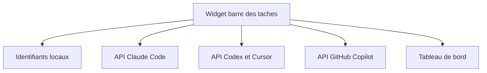

# CodeZeno/Claude-Code-Usage-Monitor

> Windows taskbar widget that displays the usage limits of Claude Code, Codex, Cursor and others.

## The problem
Subscription quotas of coding assistants are checked on separate pages, and you exceed them without warning.

## What it actually does
Reads the local credentials you are already logged in with and queries the official services directly to display usage and time before reset. Supports Claude Code, Codex, Google Antigravity, OpenCode Go, Cursor, Grok Build and GitHub Copilot, multiple accounts, themes. No intermediary server or telemetry, according to the README.

## How it is wired

Simplified diagram based on the fiche, no diagram provided.

## Trying it
```powershell
winget install CodeZeno.ClaudeCodeUsageMonitor
claude-code-usage-monitor
claude-code-usage-monitor --dashboard
```

## Cost and gotchas
Free, Windows 10 or 11 only. OpenCode Go credentials stored as JSON are in clear text: protect them like a session cookie. Building from source requires Rust 1.95.0.

## What it is not
Not a Linux or macOS tool, and not an API cost monitor: it tracks subscription quotas.

## Alternatives
No alternative cited in the README.

## For you
Worth watching: useful if you work on Windows with several coding subscriptions, but it reads your local tokens and it is a single-person project.
