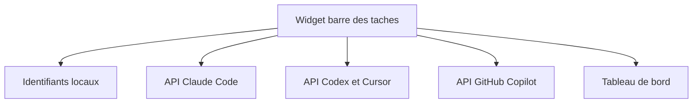

# CodeZeno/Claude-Code-Usage-Monitor

> Widget Windows dans la barre des tâches qui affiche les limites d'usage de Claude Code, Codex, Cursor et autres.

## Le problème
Les quotas d'abonnement des assistants de code se consultent dans des pages séparées, et on les dépasse sans prévenir.

## Ce que ça fait vraiment
Lit les identifiants locaux déjà connectés et interroge directement les services officiels pour afficher usage et délai avant remise à zéro. Gère Claude Code, Codex, Google Antigravity, OpenCode Go, Cursor, Grok Build et GitHub Copilot, plusieurs comptes, des thèmes. Aucun serveur intermédiaire ni télémétrie, selon le README.

## Comment c'est branché

Schéma simplifié d'après la fiche, sans diagramme fourni.

## Essayer
```powershell
winget install CodeZeno.ClaudeCodeUsageMonitor
claude-code-usage-monitor
claude-code-usage-monitor --dashboard
```

## Coût et pièges
Gratuit, Windows 10 ou 11 uniquement. Les identifiants OpenCode Go enregistrés en JSON sont en clair : à protéger comme un cookie de session. Compilation depuis les sources avec Rust 1.95.0.

## Ce que ce n'est pas
Pas un outil Linux ni macOS, et pas un moniteur de coûts d'API : il suit les quotas d'abonnement.

## Alternatives
Aucune alternative citée dans le README.

## Pour toi
À surveiller : utile si tu travailles sous Windows avec plusieurs abonnements de code, mais il lit tes jetons locaux et c'est un projet d'une seule personne.

