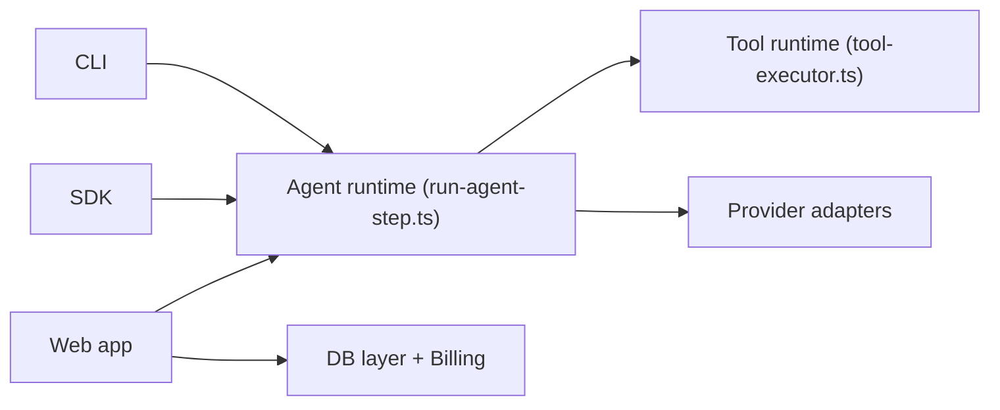

# CodebuffAI/codebuff

> Terminal coding agent (Freebuff, free and funded by ads) built on the Codebuff multi-agent framework.

## The problem
Coding assistants cost a subscription or API credits, and a single model handles everything.

## What it actually does
Freebuff offers five products (Desktop, CLI, Web, Cloud, Chat) with a catalog of models served by Freebuff. Specialized agents find files, plan, edit and review. The TypeScript/Bun monorepo contains `agent-runtime`, an SDK, a CLI, a web app with Stripe and PostgreSQL, a provider adapter and evals. The free models are funded by text ads.

## How it is wired


## Trying it
```bash
npm install -g freebuff
cd ~/my-project
freebuff
```

## Cost and gotchas
Free with daily limits (5 h per day, 4 h on VPN) and ads. Data may be used to train models or personalize ads according to the privacy policy. Some models are reserved for paid plans.

## What it is not
Not a local tool: messages and traces go through the service. The free tier depends on current capacity.

## Alternatives
No alternative named in the README.

## For you
Worth watching: the agents/tools architecture is instructive, but do not entrust it with sensitive code until the data regime has been reread.
