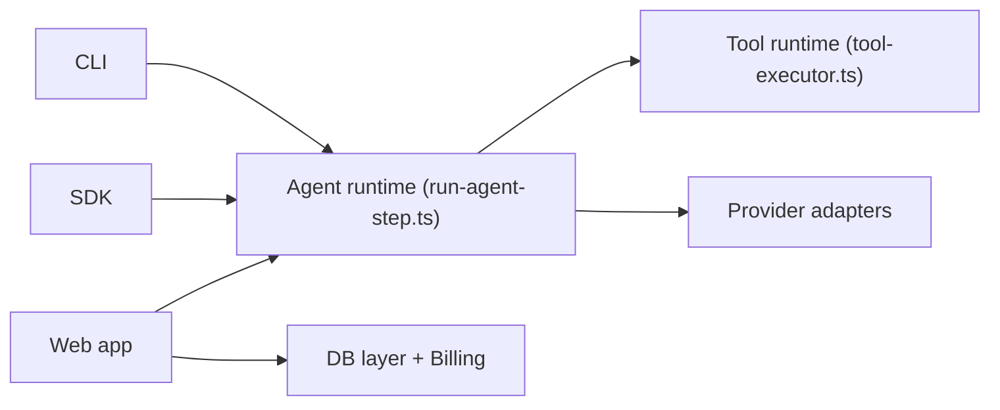

# CodebuffAI/codebuff

> Agent de code en terminal (Freebuff, gratuit financé par des pubs) bâti sur le framework multi-agents Codebuff.

## Le problème
Les assistants de code coûtent un abonnement ou des crédits d'API, et un seul modèle gère tout.

## Ce que ça fait vraiment
Freebuff propose cinq produits (Desktop, CLI, Web, Cloud, Chat) avec un catalogue de modèles servis par Freebuff. Des agents spécialisés repèrent les fichiers, planifient, éditent et relisent. Le monorepo TypeScript/Bun contient `agent-runtime`, un SDK, une CLI, une appli web avec Stripe et PostgreSQL, un adaptateur de fournisseurs et des évals. Les modèles gratuits sont financés par des pubs textuelles.

## Comment c'est branché


## Essayer
```bash
npm install -g freebuff
cd ~/my-project
freebuff
```

## Coût et pièges
Gratuit avec limites quotidiennes (5 h par jour, 4 h sur VPN) et pubs. Les données peuvent servir à entraîner des modèles ou à personnaliser les pubs selon la politique de confidentialité. Certains modèles sont réservés aux plans payants.

## Ce que ce n'est pas
Pas un outil local : messages et traces passent par le service. Le gratuit dépend de la capacité du moment.

## Alternatives
Aucune alternative nommée dans le README.

## Pour toi
À surveiller : l'architecture agents/outils est instructive, mais ne lui confie pas de code sensible tant que le régime des données n'est pas relu.

