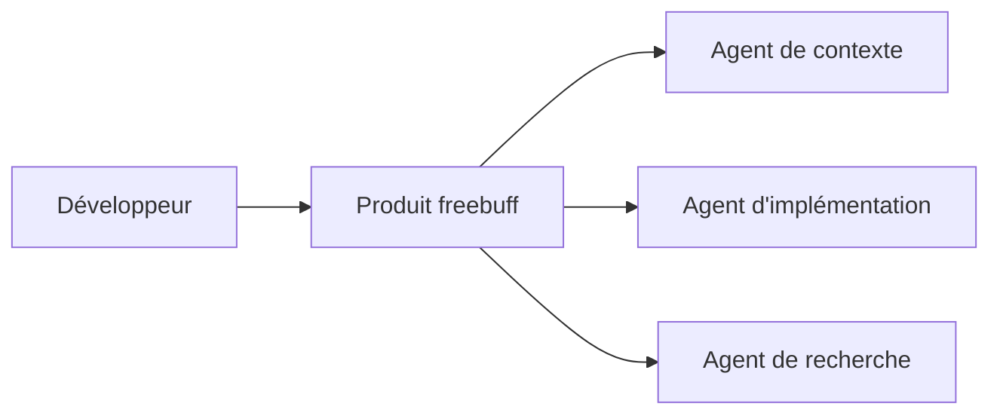

# CodebuffAI/freebuff

> Five free coding agent products funded by text ads, built on Codebuff.

## The problem
Using coding and research agents with several models is expensive in subscriptions and API keys.

## What it actually does
Offers Desktop, CLI, Web, Cloud and Chat. Specialized agents locate files, plan, edit, run commands and review. A catalog of models is offered with an hourly balance, limited access depending on the region, and extra hours through referrals. Text ads fund the models. The README describes cases where data may be used to train models.

## How it is wired
Simplified diagram based on the sheet, no diagram provided.


No diagram provided: the README describes context, implementation and research agents. Not documented in detail.

## Trying it
```bash
npm install -g freebuff
cd ~/my-project
freebuff
```

## Cost and gotchas
Free with a daily limit (5 hours with limited access, 4 on VPN). Paid plans give access to other models. Data may be used for ads and sometimes training.

## What it is not
No offline operation: the models are hosted. Not fully private: read the privacy policy.

## Alternatives
No alternative named in the README (it cites Codebuff, on which it is built).

## For you
Worth watching: a tempting free coding agent, but funded by advertising and with data usage terms to check.
