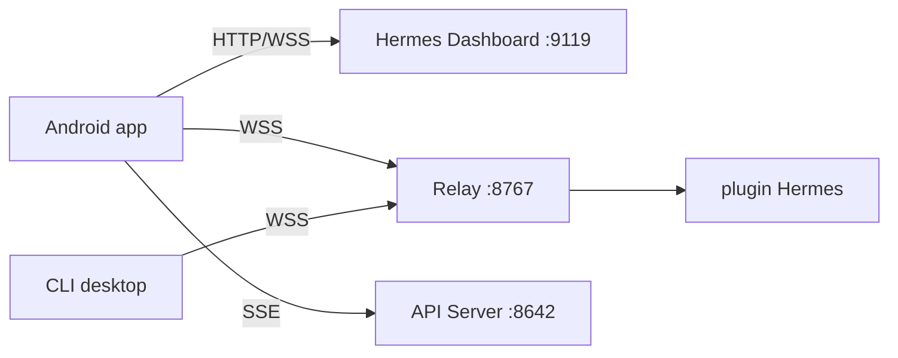

# Codename-11/hermes-relay

> Android app and CLI that give access to your Hermes agent from your phone or other machines.

## The problem
A Hermes agent runs on a machine at home: reaching it from your phone or giving it control over another computer is not supported out of the box.

## What it actually does
An Android app (streaming chat, hands-free voice, model management, keys, skills, profiles) that connects to the Hermes dashboard. An optional server-side Python plugin adds terminal, notifications, and relay. A single-binary CLI lets the agent use files, terminal, and screenshots on a paired machine, with consent.

## How it is wired


## Trying it
```bash
hermes setup --portal
hermes dashboard
hermes plugins install Codename-11/hermes-relay/plugin --enable
hermes relay doctor
hermes relay start --no-ssl
```

## Cost and gotchas
Assumes a hermes-agent already installed and reachable (LAN, Tailscale, or HTTPS). The plugin requires Python 3.11+. The CLI binaries are not signed. Screen control only exists in the APK outside the Play Store and requires precautions. More than 130 open issues.

## What it is not
Not an agent: it provides neither a model nor a brain. Not a hosted service: everything stays on your machine.

## Alternatives
No alternative named in the README.

## For you
To watch: useful only if you already use Hermes Agent; the screen and remote tool control parts call for caution.
