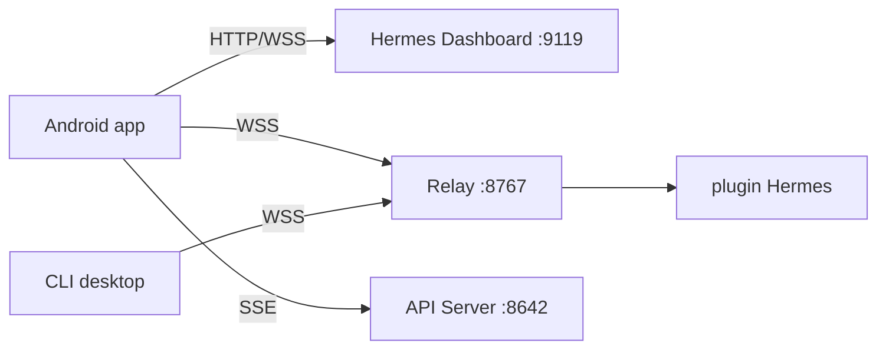

# Codename-11/hermes-relay

> Application Android et CLI qui donnent accès à ton agent Hermes depuis le téléphone ou d'autres machines.

## Le problème
Un agent Hermes tourne sur une machine à la maison : le joindre depuis le téléphone ou lui donner la main sur un autre ordinateur n'est pas prévu en standard.

## Ce que ça fait vraiment
Une application Android (chat en flux, voix mains libres, gestion de modèles, clés, skills, profils) qui se connecte au tableau de bord Hermes. Un plugin Python serveur optionnel ajoute terminal, notifications et relais. Un CLI en binaire unique laisse l'agent utiliser fichiers, terminal et captures sur une machine appairée, avec consentement.

## Comment c'est branché


## Essayer
```bash
hermes setup --portal
hermes dashboard
hermes plugins install Codename-11/hermes-relay/plugin --enable
hermes relay doctor
hermes relay start --no-ssl
```

## Coût et pièges
Suppose un agent hermes-agent déjà installé et joignable (LAN, Tailscale ou HTTPS). Le plugin demande Python 3.11+. Les binaires du CLI ne sont pas signés. Le contrôle de l'écran n'existe que dans l'APK hors Play et exige des précautions. Plus de 130 issues ouvertes.

## Ce que ce n'est pas
Pas un agent : il ne fournit ni modèle ni cerveau. Pas un service hébergé : tout reste sur ta machine.

## Alternatives
Aucune alternative nommée dans le README.

## Pour toi
Surveiller : utile seulement si tu utilises déjà Hermes Agent ; la partie contrôle d'écran et d'outils distants demande de la prudence.

