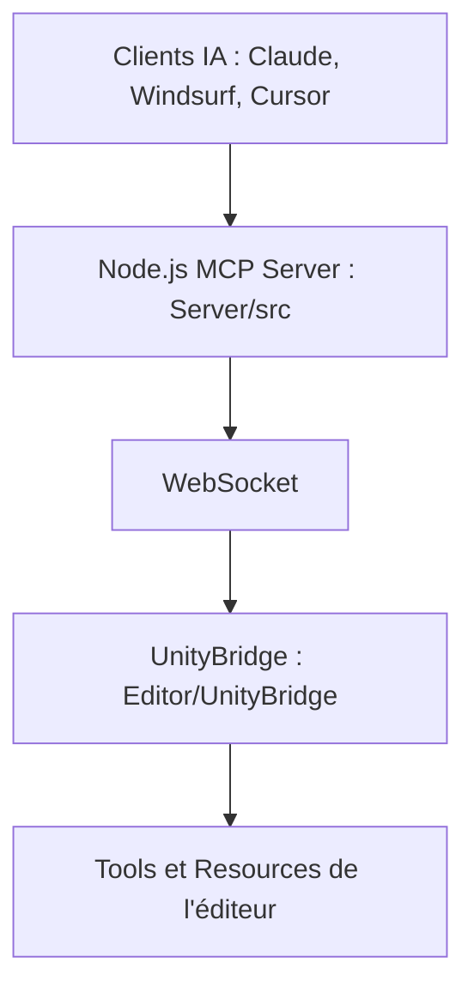

# CoderGamester/mcp-unity

> MCP bridge between the Unity editor and AI assistants (Claude Code, Cursor, Codex), for Unity developers.

## The problem
A coding assistant cannot see the Unity editor: it can neither create objects, read the console, nor run the tests.

## What it actually does
A WebSocket server runs inside Unity, a Node.js server speaks MCP to the clients. The tools act on scenes, GameObjects, materials, prefabs, packages and tests; `unity://` resources expose hierarchy, logs and assets. The authentication token is generated per project, and `add_package` is disabled by default.

## How it is wired


## Trying it
```bash
# Unity Package Manager > Add package from git URL
# https://github.com/CoderGamester/mcp-unity.git
# Puis : Tools > MCP Unity > Server Window > Start Server
cd ABSOLUTE/PATH/TO/mcp-unity/Server~
npm install
npm run build
node build/index.js
```

## Cost and gotchas
Unity 6 or higher, Node 18 or higher. The package cache paths change with every update: re-run Configure. Remote access goes over unencrypted ws://.

## What it is not
Not a game generator: it exposes actions, the AI still needs to be guided. The 1.5.x versions reject 1.4.x bridges. Windows and macOS are described, Linux is not documented.

## Alternatives
No alternative named in the README.

## For you
Adopt it if you do Unity with a coding agent: MIT, clear scope, token-based security, a single maintainer to keep in mind.
