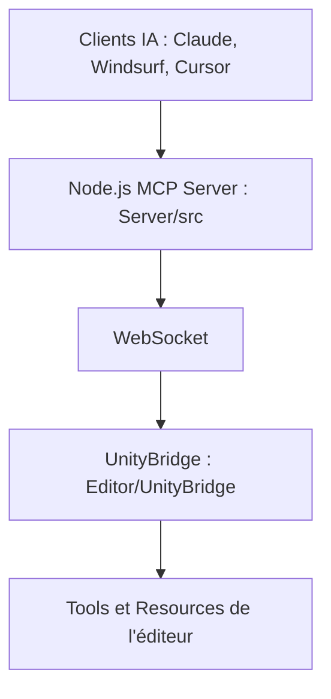

# CoderGamester/mcp-unity

> Pont MCP entre l'éditeur Unity et les assistants IA (Claude Code, Cursor, Codex), pour développeurs Unity.

## Le problème
Un assistant de code ne voit pas l'éditeur Unity : il ne peut ni créer d'objets, ni lire la console, ni lancer les tests.

## Ce que ça fait vraiment
Un serveur WebSocket tourne dans Unity, un serveur Node.js parle MCP aux clients. Les outils agissent sur scènes, GameObjects, matériaux, prefabs, packages et tests ; des ressources `unity://` exposent hiérarchie, logs et assets. Le jeton d'authentification est généré par projet, et `add_package` est désactivé par défaut.

## Comment c'est branché


## Essayer
```bash
# Unity Package Manager > Add package from git URL
# https://github.com/CoderGamester/mcp-unity.git
# Puis : Tools > MCP Unity > Server Window > Start Server
cd ABSOLUTE/PATH/TO/mcp-unity/Server~
npm install
npm run build
node build/index.js
```

## Coût et pièges
Unity 6 ou plus, Node 18 ou plus. Les chemins de cache du paquet changent à chaque mise à jour : relancer Configure. L'accès distant passe en ws:// non chiffré.

## Ce que ce n'est pas
Pas un générateur de jeux : il expose des actions, l'IA reste à guider. Les versions 1.5.x rejettent les ponts 1.4.x. Windows et macOS sont décrits, Linux non documenté.

## Alternatives
Aucune alternative nommée dans le README.

## Pour toi
À adopter si tu fais du Unity avec un agent de code : MIT, périmètre clair, sécurité par jeton, un seul mainteneur à garder en tête.

