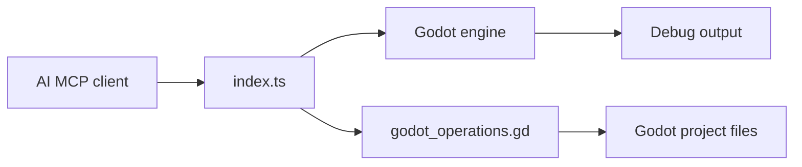

# Coding-Solo/godot-mcp

> MCP server that lets an agent launch, debug and edit Godot projects.

## The problem
An agent writing Godot code never sees the result: no execution, no error logs.

## What it actually does
MCP tools: launch the editor, run a project in debug, retrieve console output, stop.
List and analyze projects, create scenes, add nodes, load sprites, export a MeshLibrary.
UID management (Godot 4.4+).
Simple commands through the Godot CLI, complex operations through a `godot_operations.gd` script driven by JSON.

## How it is wired


## Trying it
```bash
claude mcp add godot -- npx @coding-solo/godot-mcp
git clone https://github.com/Coding-Solo/godot-mcp.git
cd godot-mcp
npm install
npm run build
```

## Cost and gotchas
Free; Godot and Node 18+ installed, `GODOT_PATH` if detection fails.

## What it is not
Not a full editor: scope limited to the listed operations. The README suggests auto-approving all tools, which removes all control.

## Alternatives
No alternative named in the README.

## For you
Ignore outside game development: good example of an agent-execution feedback loop, but no direct data/AI use.
