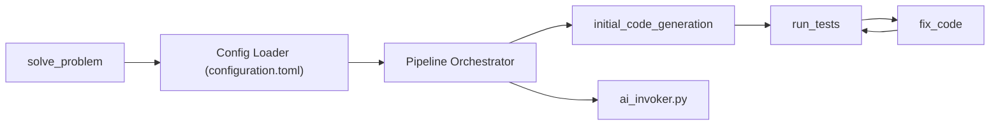

# Codium-ai/AlphaCodium

> Official implementation of a test-driven iterative flow to generate competitive-programming code with an LLM.

## The problem
Prompt tricks for natural language work poorly on code: exact syntax, edge cases, details of the problem statement.

## What it actually does
The flow chains: restating the problem, reflection, possible solutions, AI-generated tests, initial code, execution on public tests then AI tests, iterative fixes, choice of the best solution. The configuration (`configuration.toml`) sets each step and the model. Three commands: `solve_problem`, `solve_dataset`, `evaluate_dataset`. According to the authors, GPT-4's pass@5 success rate goes from 19% to 44% on the CodeContests validation set, with 15 to 20 calls per solution.

## How it is wired


## Trying it
```bash
python3 -m venv venv
source ./venv/bin/activate
pip install -r requirements.txt
python -m alpha_codium.solve_problem --dataset_name /path/to/dataset --split_name test --problem_number 0
```

## Cost and gotchas
An OpenAI key is needed in `alpha_codium/settings/.secrets.toml` and the dataset must be downloaded from Hugging Face. Solving a whole dataset can take several days with a large model. The AGPL-3.0 license is copyleft. Last push in November 2024.

## What it is not
It is not a code assistant for real projects: it targets contest problems in the CodeContests format. The figures are the authors', with 2023 models with an 8192-token context. The README warns that even 15 to 20 calls per solution may be too many for some applications.

## Alternatives
No alternative named in the README.

## For you
Ignore as a repository: frozen since late 2024, under AGPL and tied to old models; instead keep the README's principles (YAML output, double validation, modular code) for your own code agents.
