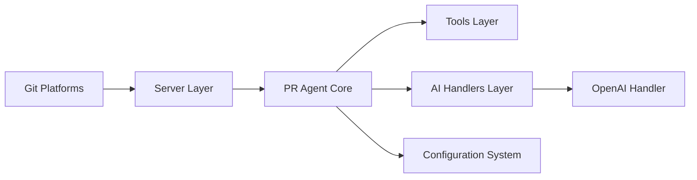

# Codium-ai/pr-agent

> Open-source LLM pull request review agent, for teams on GitHub, GitLab, Bitbucket or Azure DevOps.

## The problem
PR reviews are slow; describing, reviewing and suggesting improvements by hand ties up reviewers.

## What it actually does
Tools `/describe`, `/review`, `/improve`, `/ask` and `/similar_issue`, each with a single LLM call (~30 s). Deployable as a GitHub Action, CLI, Docker, self-hosted webhook. PR compression for large diffs, prompts configurable in JSON, any model through LiteLLM (OpenAI, Claude, Gemini, Ollama…). Community project inherited from Qodo, distinct from the Qodo offering. `/help_docs` has been disabled since v0.36.1.

## How it is wired


## Trying it
```bash
pip install pr-agent
export OPENAI_KEY=your_key_here
pr-agent --pr_url https://github.com/owner/repo/pull/123 review
```

## Cost and gotchas
Each LLM call is billed to your key (OpenAI or other). Docker images are under `pragent/pr-agent` since 0.34.2. A credential exposure problem (#2445) led to `/help_docs` being disabled. License not specified in the catalog.

## What it is not
Not the Qodo offering: the README spells out the distinction. Does not replace a human review.

## Alternatives
The README cites the Qodo offering, with a free version for open source.

## For you
Adopt as a trial if you want an automatic, self-hosted PR reviewer; check the license before integrating it in a company.
