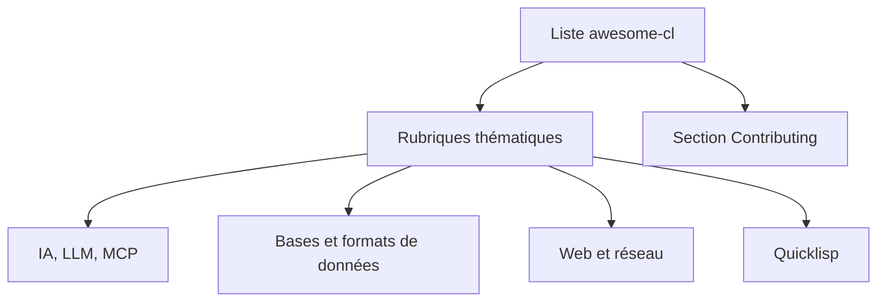

# CodyReichert/awesome-cl

> Annotated list of Common Lisp libraries, with AI, data, web and tooling sections, for Lisp developers.

## The problem
The Common Lisp ecosystem is scattered: finding which library is solid for a given task means digging through Quicklisp at random.

## What it actually does
A list sorted by section (AI and LLM, learning, databases, data formats, web, scientific computing, parallelism, editors...). A star marks de facto standards, a thumbs-up marks the authors' recommended picks. Most entries are available through Quicklisp. On the AI side: MCP servers (cl-MCP, mcp-lisp), llama.cl, MGL, OpenAI and Ollama clients.

## How it is wired
Simplified diagram based on the fiche, no diagram provided.

## Trying it
No documented command: it is a list to read and browse.

## Cost and gotchas
Free. GNU Free Documentation License present but not identified by GitHub: to be checked. Each listed library has its own license (MIT, AGPL, GPL...) to check before use.

## What it is not
It is not a Lisp learning guide nor an objective ranking: the thumbs-ups are preferences. The list does not guarantee that the cited projects are maintained. The README was truncated for this fiche.

## Alternatives
No alternative named in the README, apart from awesome-cl-software for software.

## For you
Ignore: useful only if you write Common Lisp. The AI and MCP sections are curiosities, far from the usual Python libraries.
