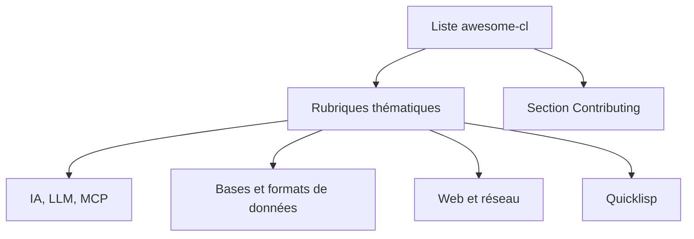

# CodyReichert/awesome-cl

> Liste commentée de bibliothèques Common Lisp, avec rubriques IA, données, web et outils, pour les développeurs Lisp.

## Le problème
L'écosystème Common Lisp est dispersé : trouver quelle bibliothèque est solide pour une tâche donnée demande de fouiller Quicklisp au hasard.

## Ce que ça fait vraiment
Une liste triée par rubriques (IA et LLM, apprentissage, bases de données, formats de données, web, calcul scientifique, parallélisme, éditeurs...). Une étoile marque les standards de fait, un pouce les choix recommandés par les auteurs. La plupart des entrées sont disponibles via Quicklisp. Côté IA : serveurs MCP (cl-MCP, mcp-lisp), llama.cl, MGL, clients OpenAI et Ollama.

## Comment c'est branché
Schéma simplifié d'après la fiche, sans diagramme fourni.

## Essayer
Aucune commande documentée : c'est une liste à lire et à parcourir.

## Coût et pièges
Gratuit. Licence GNU Free Documentation présente mais non identifiée par GitHub : à vérifier. Chaque bibliothèque listée a sa propre licence (MIT, AGPL, GPL...) à contrôler avant usage.

## Ce que ce n'est pas
Ce n'est pas un guide d'apprentissage de Lisp ni un classement objectif : les pouces sont des préférences. La liste ne garantit pas la maintenance des projets cités. Le README a été tronqué pour cette fiche.

## Alternatives
Aucune alternative nommée dans le README, hors awesome-cl-software pour les logiciels.

## Pour toi
À ignorer : utile seulement si tu écris du Common Lisp. Les rubriques IA et MCP sont des curiosités, loin des bibliothèques Python habituelles.

