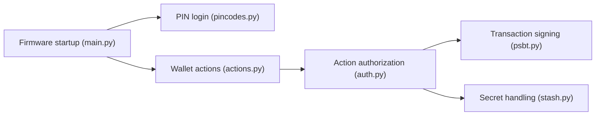

# Coldcard/firmware

> Firmware of the Coldcard Bitcoin hardware wallet, with simulator and reproducible builds.

## The problem
A hardware wallet must be auditable: the binary on the device must match the source code.

## What it actually does
MicroPython/C wallet code: PIN, secrets, PSBT signing, multisig, backups, USB, with a desktop simulator. Reproducible builds via Docker. A security notice at the top reports that poor entropy affected generated secrets from 2021 to July 2026, with minimum trusted versions listed.

## How it is wired


## Trying it
```bash
git clone --recursive https://github.com/Coldcard/firmware.git
cd firmware/stm32
make -f MK4-Makefile repro
cd unix && ./simulator.py
```

## Cost and gotchas
Docker and make for reproduction; long build (submodules). Path without spaces required. License present but not identified by GitHub: to be checked.

## What it is not
Not software to install in order to use the wallet. The security notice requires regenerating secrets created with versions older than the indicated levels.

## Alternatives
No alternative named in the README.

## For you
Watch only if you own a Coldcard (read the security notice first); outside the data/AI scope.
