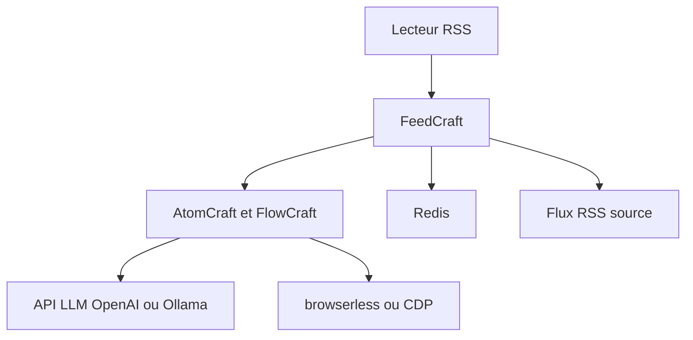

# Colin-XKL/FeedCraft

> RSS middleware: extracts text, translates, summarizes with AI and filters articles, with a visual RSS generator.

## The problem
RSS feeds are often truncated, in a foreign language or full of ads, and RSS readers do not reprocess them.

## What it actually does
A "craft" is applied to a feed by prefixing its URL: `proxy`, `limit`, `fulltext`, `introduction`, `summary`, `translate-title`, `translate-content`, `beautify-content`, `ignore-advertorial`. Crafts can be combined into a FlowCraft, and a Recipe links a feed to a craft. A generator turns web pages, JSON APIs or searches into RSS feeds. AI calls go through an OpenAI-compatible API or Ollama.

## How it is wired


## Trying it
```yaml
services:
  app.feed-craft:
    image: ghcr.io/colin-xkl/feed-craft
    ports:
      - "10088:80"
    volumes:
      - ./feed-craft-db:/usr/local/feed-craft/db
```
The README adds the variables `FC_LLM_API_BASE`, `FC_LLM_API_KEY` and `FC_REDIS_URI`. Default admin account `admin` / `adminadmin`: change it.

## Cost and gotchas
The AI features consume your LLM API key. Advanced rendering requires a browser service (browserless) and Redis. The demo instance is reserved for trials.

## What it is not
Not an RSS reader: a middleware to place in front of yours. The main documentation in the README is in Chinese.

## Alternatives
No alternative named in the README.

## For you
Keep an eye on it: good for automating summaries and translations of your watch feeds with an LLM, if you accept managing Docker and an API key.
