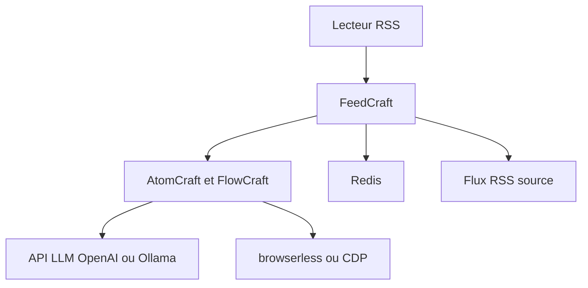

# Colin-XKL/FeedCraft

> Intergiciel RSS : extrait le texte, traduit, résume par IA et filtre les articles, avec un générateur RSS visuel.

## Le problème
Les flux RSS sont souvent tronqués, en langue étrangère ou pleins de publicité, et les lecteurs RSS ne les retraitent pas.

## Ce que ça fait vraiment
Un « craft » s'applique à un flux en préfixant son URL : `proxy`, `limit`, `fulltext`, `introduction`, `summary`, `translate-title`, `translate-content`, `beautify-content`, `ignore-advertorial`. Les crafts se combinent en FlowCraft, et un Recipe lie un flux à un craft. Un générateur transforme pages web, API JSON ou recherches en flux RSS. Les appels IA passent par une API compatible OpenAI ou Ollama.

## Comment c'est branché


## Essayer
```yaml
services:
  app.feed-craft:
    image: ghcr.io/colin-xkl/feed-craft
    ports:
      - "10088:80"
    volumes:
      - ./feed-craft-db:/usr/local/feed-craft/db
```
Le README ajoute les variables `FC_LLM_API_BASE`, `FC_LLM_API_KEY` et `FC_REDIS_URI`. Compte admin par défaut `admin` / `adminadmin` : à changer.

## Coût et pièges
Les fonctions IA consomment ta clé d'API LLM. Le rendu avancé demande un service de navigateur (browserless) et Redis. L'instance de démonstration est réservée aux essais.

## Ce que ce n'est pas
Pas un lecteur RSS : un intergiciel à placer devant le tien. La documentation principale du README est en chinois.

## Alternatives
Aucune alternative nommée dans le README.

## Pour toi
Surveiller : bon pour automatiser résumés et traductions de tes flux de veille avec un LLM, si tu acceptes de gérer Docker et une clé d'API.

