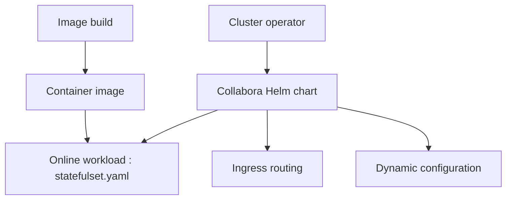

# CollaboraOnline/online

> Online office suite of which GitHub only keeps the issue tracker, the Docker image and the Helm chart.

## The problem
Host your own collaborative office documents without depending on a third-party cloud service.

## What it actually does
This repository is not the source code: development happens on Gerrit. It holds the tickets, the nightly container image, the Helm chart and the build resources. The chart renders a StatefulSet, an ingress, a reverse proxy, dynamic configuration and monitoring.

## How it is wired

## Trying it
No command documented in this README. Build instructions are referred to the `CollaboraOnline/online.mirror` mirror and to Gerrit.

## Cost and gotchas
A Kubernetes cluster is needed for the chart. Code changes go to Gerrit, not through pull requests; PRs only concern Helm and the Docker image.

## What it is not
Neither the application code nor its documentation: editing and storage flows cannot be verified here. License not identified by GitHub.

## Alternatives
No alternative named in the README (only the `CollaboraOnline/online.mirror` mirror is cited).

## For you
Worth watching: useful if you need to deploy an office suite on Kubernetes, but outside data/AI work, and the license needs checking.
