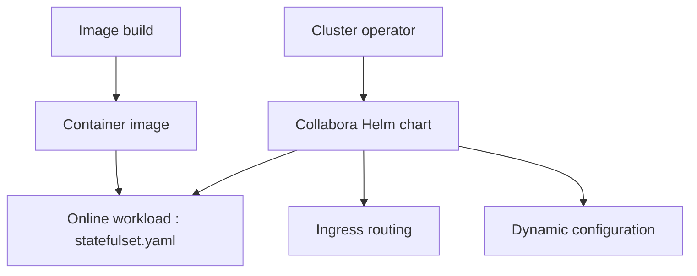

# CollaboraOnline/online

> Suite bureautique en ligne dont GitHub ne garde que le suivi des tickets, l'image Docker et le chart Helm.

## Le problème
Hébergez vos propres documents bureautiques collaboratifs sans dépendre d'un service cloud tiers.

## Ce que ça fait vraiment
Ce dépôt n'est pas le code source : le développement se fait sur Gerrit. On y trouve les tickets, l'image de conteneur nightly, le chart Helm et les ressources de build. Le chart rend un StatefulSet, un ingress, un reverse proxy, une configuration dynamique et une supervision.

## Comment c'est branché

## Essayer
Aucune commande documentée dans ce README. Les instructions de build sont renvoyées au miroir `CollaboraOnline/online.mirror` et à Gerrit.

## Coût et pièges
Il faut un cluster Kubernetes pour le chart. Les modifications du code vont sur Gerrit, pas en pull request ; les PR ne concernent que Helm et l'image Docker.

## Ce que ce n'est pas
Ni le code de l'application ni sa documentation : les flux d'édition et de stockage ne sont pas vérifiables ici. Licence non identifiée par GitHub.

## Alternatives
Aucune alternative nommée dans le README (seul le miroir `CollaboraOnline/online.mirror` est cité).

## Pour toi
À surveiller : utile si tu dois déployer une suite bureautique sur Kubernetes, mais hors du travail data/IA, et la licence est à vérifier.

