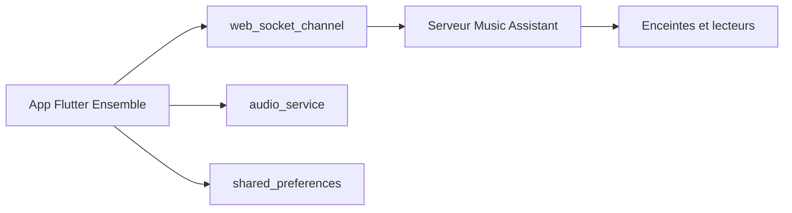

# CollotsSpot/Ensemble

> Unofficial Android client for Music Assistant: playback on the phone and remote control of speakers.

## The problem
You need a mobile app to control a Music Assistant library and its speakers from the phone or the car.

## What it actually does
Connects to a Music Assistant server over WebSocket. Lets you play on the phone (Sendspin protocol), control several players, manage the queue, and browse music, radios, podcasts and audiobooks. Supports Android Auto and keeps an offline cache.

## How it is wired

Simplified diagram based on the sheet, no diagram provided.

## Trying it
```bash
git clone https://github.com/CollotsSpot/Ensemble.git
cd Ensemble
flutter pub get
flutter pub run flutter_launcher_icons
flutter build apk --release
```

## Cost and gotchas
Free, but requires a Music Assistant server (v2.7.0 beta 20 or later). Not on the Play Store: Android Auto requires enabling unknown sources. No license: reuse rights are unclear.

## What it is not
Not an official Music Assistant project. The code was produced with Claude Code and Gemini CLI, according to the author. No iOS version mentioned.

## Alternatives
Ensemble TV: a simple Android TV client by the same author, to display the current playback.

## For you
Unrelated to data, AI or MLOps, and with no license: ignore unless you already have a Music Assistant server.
