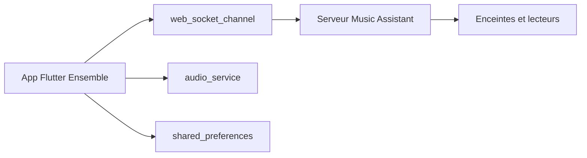

# CollotsSpot/Ensemble

> Client Android non officiel pour Music Assistant : lecture sur le téléphone et télécommande des enceintes.

## Le problème
Il faut une application mobile pour piloter une bibliothèque Music Assistant et ses enceintes depuis le téléphone ou la voiture.

## Ce que ça fait vraiment
Se connecte à un serveur Music Assistant par WebSocket. Permet de lire sur le téléphone (protocole Sendspin), de piloter plusieurs lecteurs, de gérer la file, de parcourir musique, radios, podcasts et livres audio. Prend en charge Android Auto et garde un cache hors ligne.

## Comment c'est branché

Schéma simplifié d'après la fiche, sans diagramme fourni.

## Essayer
```bash
git clone https://github.com/CollotsSpot/Ensemble.git
cd Ensemble
flutter pub get
flutter pub run flutter_launcher_icons
flutter build apk --release
```

## Coût et pièges
Gratuit, mais exige un serveur Music Assistant (v2.7.0 beta 20 ou plus). Pas de Play Store : Android Auto demande d'activer les sources inconnues. Licence absente : droits de réutilisation flous.

## Ce que ce n'est pas
Pas un projet officiel de Music Assistant. Le code a été produit avec Claude Code et Gemini CLI, selon l'auteur. Pas de version iOS indiquée.

## Alternatives
Ensemble TV : client Android TV simple du même auteur, pour afficher la lecture en cours.

## Pour toi
Sans rapport avec data, IA ou MLOps, et sans licence : à ignorer sauf si tu as déjà un serveur Music Assistant.

