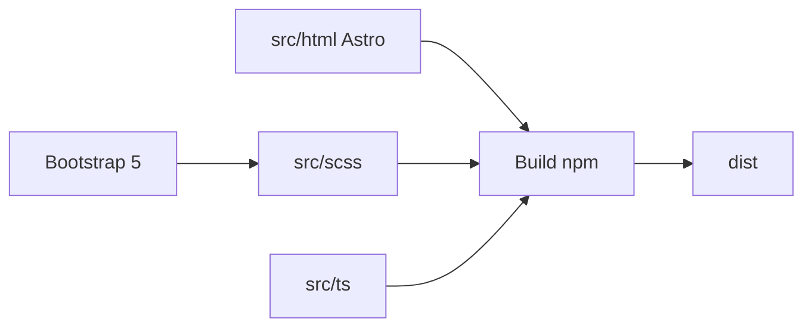

# ColorlibHQ/AdminLTE

> Dashboard template built with Bootstrap 5 and native JavaScript, without jQuery.

## The problem
Creating an administrative interface (menus, maps, tables, forms) from scratch requires a significant amount of HTML and CSS.

## What it actually does
Provides an AdminLTE 4 template: layout, components, light/dark themes, RTL support, and dozens of demo pages (calendar, Kanban, chat, Tabulator tables). Sources are Astro, SCSS, and TypeScript, compiled in `dist`. Official versions are available for React, Vue, Laravel, Django, Symfony, Angular, ASP.NET, and Drupal.

## How it is wired


## Trying it
```bash
npm install admin-lte@4
```

## Cost and gotchas
Free; premium, paid templates are also available. Only deploy the `dist` files: the demo pages exposed in production are the source of the disputed CVE-2021-36471. Migration from v3 is not backward-compatible.

## What it is not
Not an application framework: only the user interface layer.

## Alternatives
No alternative is specified in the README file.

## For you
Not relevant for a data/MLOps profile: only useful if you are building your own internal dashboard.
