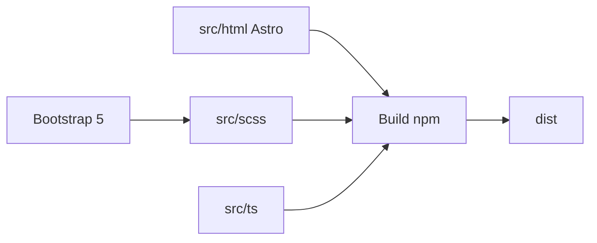

# ColorlibHQ/AdminLTE

> Modèle de tableau de bord d'administration en Bootstrap 5 et JavaScript natif, sans jQuery.

## Le problème
Construire une interface d'administration (menus, cartes, tableaux, formulaires) from scratch demande beaucoup de HTML et de CSS.

## Ce que ça fait vraiment
Fournit un gabarit AdminLTE 4 : mise en page, composants, thèmes clair/sombre, RTL, dizaines de pages de démo (calendrier, kanban, chat, tableaux Tabulator). Sources Astro, SCSS et TypeScript compilées dans `dist`. Éditions officielles pour React, Vue, Laravel, Django, Symfony, Angular, ASP.NET, Drupal.

## Comment c'est branché


## Essayer
```bash
npm install admin-lte@4
```

## Coût et pièges
Gratuit ; des gabarits premium payants existent. Déployer seulement les fichiers `dist` : les pages de démo exposées en production sont à l'origine du CVE-2021-36471 contesté. Migration depuis v3 non rétrocompatible.

## Ce que ce n'est pas
Pas un framework applicatif : seulement la couche d'interface.

## Alternatives
Aucune alternative nommée dans le README.

## Pour toi
À ignorer pour un profil data/MLOps : utile seulement si tu habilles toi-même un tableau de bord interne.

