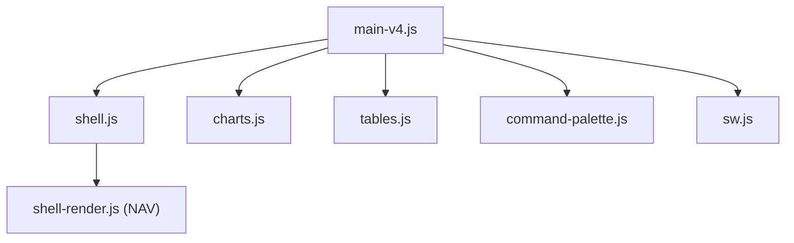

# ColorlibHQ/gentelella

> Free admin dashboard template in plain JavaScript, SCSS and Vite, without Bootstrap.

## The problem
Starting from a blank page for a back office or a dashboard takes time.

## What it actually does
58 static HTML pages: dashboards, forms, DataTables tables, 20 ECharts charts, inbox, kanban, calendar, file manager. Dark mode, PWA, ⌘K palette, theme generator. No backend, no real authentication, no real time.

## How it is wired


## Trying it
```bash
git clone https://github.com/ColorlibHQ/gentelella.git
cd gentelella
npm install
npm run dev
npm run build
```

## Cost and gotchas
Free, MIT. No formal accessibility audit. The README also points to paid premium templates.

## What it is not
Not an application: a static interface to plug into your API. Forms are not persistent.

## Alternatives
No alternative named in the README (it points to paid DashboardPack templates).

## For you
Keep an eye on it: useful for an internal demo dashboard of a model; for Streamlit or BI, it is not the right tool.
