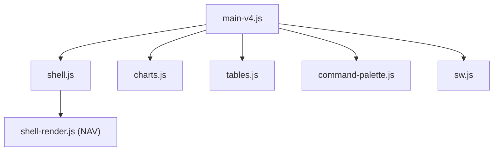

# ColorlibHQ/gentelella

> Gabarit de tableau de bord d'administration gratuit en JavaScript pur, SCSS et Vite, sans Bootstrap.

## Le problème
Partir d'une page blanche pour un back-office ou un tableau de bord prend du temps.

## Ce que ça fait vraiment
58 pages HTML statiques : tableaux de bord, formulaires, tables DataTables, 20 graphiques ECharts, boîte de réception, kanban, calendrier, gestionnaire de fichiers. Mode sombre, PWA, palette ⌘K, générateur de thème. Aucun backend, aucune authentification réelle, aucun temps réel.

## Comment c'est branché


## Essayer
```bash
git clone https://github.com/ColorlibHQ/gentelella.git
cd gentelella
npm install
npm run dev
npm run build
```

## Coût et pièges
Gratuit, MIT. Pas d'audit d'accessibilité formel. Le README oriente aussi vers des gabarits premium payants.

## Ce que ce n'est pas
Pas une application : interface statique à brancher sur ton API. Formulaires non persistants.

## Alternatives
Aucune alternative nommée dans le README (renvoie à des gabarits payants DashboardPack).

## Pour toi
Surveiller : sert pour un tableau de bord interne de démonstration d'un modèle ; pour du Streamlit ou du BI, ce n'est pas l'outil.

