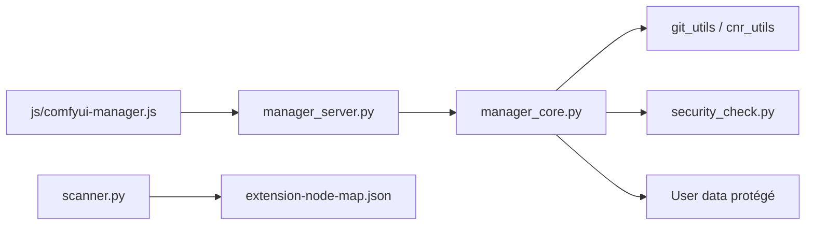

# Comfy-Org/ComfyUI-Manager

> ComfyUI extension to install, update, disable and remove custom nodes and models.

## The problem
ComfyUI custom nodes are installed by hand, with dependency conflicts that are hard to track.

## What it actually does
A menu inside ComfyUI that lists nodes and models (local database or remote channel), installs them through Git or through the `registry.comfy.org` registry, and handles restorable snapshots, shareable components, repair of old nodes and workflow sharing. Options: `uv` instead of pip, package blocklists, security levels, public/private/offline network mode. A `cm-cli` allows use without the interface.

## How it is wired


## Trying it
```bash
cd ComfyUI/custom_nodes
git clone https://github.com/ltdrdata/ComfyUI-Manager comfyui-manager
pip install comfy-cli
comfy install
```

## Cost and gotchas
Installing a node runs third-party code: set `security_level`. Installation by Git URL or pip is disabled by default and limited to loopback. The folder must be exactly `custom_nodes/comfyui-manager`. 477 open issues. GPL-3.0 license.

## What it is not
It does not guarantee that the installed nodes work (README warning). It is not ComfyUI itself.

## Alternatives
`comfy-cli`: recommended by the README to install ComfyUI and the Manager in one go.

## For you
Adopt if you use ComfyUI for image generation: it is the de facto entry point for managing nodes, with the security safeguards to turn on.
