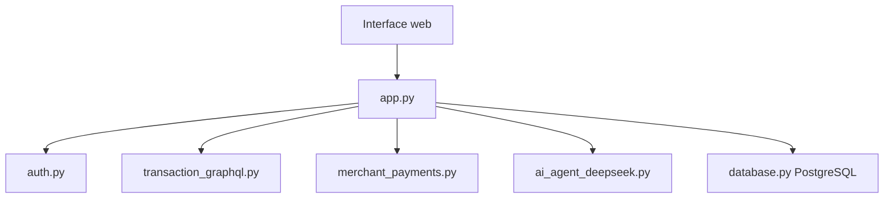

# Commando-X/vuln-bank

> Deliberately vulnerable Flask banking application, for practicing web, API and LLM security.

## The problem
Practicing application security requires a legal, disposable target, without touching a real system.

## What it actually does
Fake bank (transfers, loans, virtual cards, bills, merchant API, GraphQL analytics) riddled with flaws: SQL injection, weak JWT, BOLA, XSS, SSRF, race conditions. An AI support agent, using DeepSeek or a simulated mode, exposes prompt injections. A container neutralizes stored XSS after 15 minutes.

## How it is wired


## Trying it
```bash
git clone https://github.com/Commando-X/vuln-bank.git
cd vuln-bank
docker-compose up -d --build
```

## Cost and gotchas
Free. Application to expose only in an isolated environment: plaintext passwords, debug mode on, `.env` file provided. The real AI agent uses the DeepSeek API, at your expense.

## What it is not
Not an attack tool: it is a training target. No production use.

## Alternatives
No alternative named in the README.

## For you
Watch: the LLM part (prompt injection, database access by the AI) offers a useful practice ground for anyone deploying agents.
