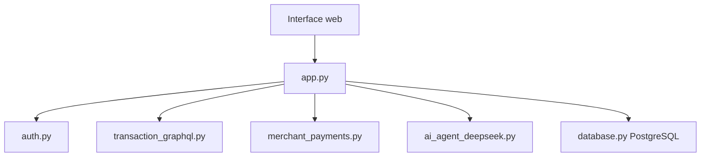

# Commando-X/vuln-bank

> Application bancaire Flask volontairement vulnérable, pour s'entraîner à la sécurité web, API et LLM.

## Le problème
S'exercer à la sécurité applicative suppose une cible légale et jetable, sans toucher un vrai système.

## Ce que ça fait vraiment
Banque factice (virements, prêts, cartes virtuelles, factures, API marchande, analyses GraphQL) bourrée de failles : injection SQL, JWT faible, BOLA, XSS, SSRF, conditions de concurrence. Un agent de support IA, avec DeepSeek ou un mode simulé, expose des injections de prompt. Un conteneur neutralise le XSS stocké après 15 minutes.

## Comment c'est branché


## Essayer
```bash
git clone https://github.com/Commando-X/vuln-bank.git
cd vuln-bank
docker-compose up -d --build
```

## Coût et pièges
Gratuit. Application à n'exposer qu'en environnement isolé : mots de passe en clair, mode debug actif, fichier `.env` fourni. L'agent IA réel utilise l'API DeepSeek, à ta charge.

## Ce que ce n'est pas
Pas un outil d'attaque : c'est une cible d'entraînement. Aucun usage en production.

## Alternatives
Aucune alternative nommée dans le README.

## Pour toi
Surveiller : la partie LLM (injection de prompt, accès base par l'IA) offre un terrain d'exercice utile pour qui déploie des agents.

