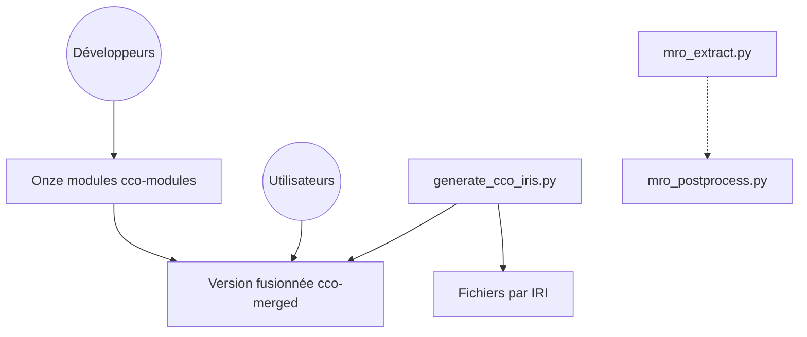

# CommonCoreOntology/CommonCoreOntologies

> A suite of eleven mid-level ontologies built on BFO, for modeling data from any domain.

## The problem
Heterogeneous datasets need a shared, logically well-defined vocabulary (person, facility, date, measurement).

## What it actually does
CCO provides eleven ontologies: geospatial, information entity, event, time, agent, quality, units of measure, currency, facility, artifact and extended relations. They extend BFO (a high-level ISO standard). The repository contains the merged file, the modules, extensions such as the Modal Relation Ontology, SPARQL checking queries and per-IRI files.

## How it is wired

## Trying it
No documented command: the README describes the repository contents (import the modules or the merged file into an ontology tool).

## Cost and gotchas
Free, BSD-3-Clause license. You need an ontology tool (such as Protégé, not named by the README) to use them; governance goes through a committee, and the IEEE standard is under evaluation.

## What it is not
It is not executable software nor a populated knowledge graph: these are vocabularies to be extended per domain. Domain-specific content is deliberately excluded.

## Alternatives
- Basic Formal Ontology (BFO): a top-level ontology of which CCO is a mid-level extension.

## For you
Worth watching if you build knowledge graphs or data semantics; it imposes BFO and demands ontologist work.
