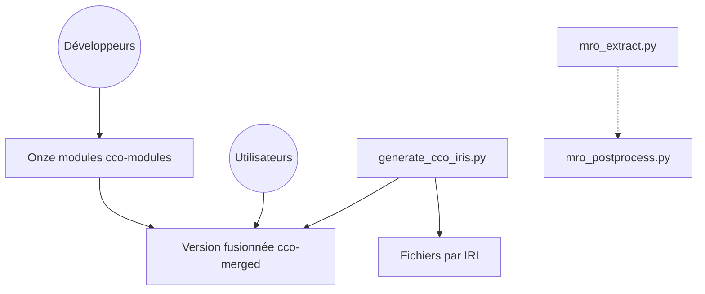

# CommonCoreOntology/CommonCoreOntologies

> Suite de onze ontologies de niveau intermédiaire fondées sur BFO, pour modéliser des données de tous domaines.

## Le problème
Des jeux de données hétérogènes ont besoin d'un vocabulaire commun (personne, installation, date, mesure) bien défini logiquement.

## Ce que ça fait vraiment
CCO fournit onze ontologies : géospatial, entité d'information, événement, temps, agent, qualité, unités de mesure, devises, installation, artefact et relations étendues. Elles étendent BFO (norme ISO de haut niveau). Le dépôt contient le fichier fusionné, les modules, des extensions comme la Modal Relation Ontology, des requêtes SPARQL de contrôle et des fichiers par IRI.

## Comment c'est branché

## Essayer
Aucune commande documentée : le README décrit le contenu du dépôt (importer les modules ou le fichier fusionné dans un outil d'ontologies).

## Coût et pièges
Gratuit, licence BSD-3-Clause. Il faut un outil d'ontologies (type Protégé, non nommé par le README) pour les exploiter ; la gouvernance passe par un comité, et la norme IEEE est en évaluation.

## Ce que ce n'est pas
Ce n'est pas un logiciel exécutable ni un graphe de connaissances rempli : ce sont des vocabulaires à étendre par domaine. Le contenu propre à un domaine est volontairement exclu.

## Alternatives
- Basic Formal Ontology (BFO) : ontologie de haut niveau dont CCO est une extension de niveau intermédiaire.

## Pour toi
À surveiller si tu construis des graphes de connaissances ou de la sémantique de données ; il impose BFO et exige du travail d'ontologue.

