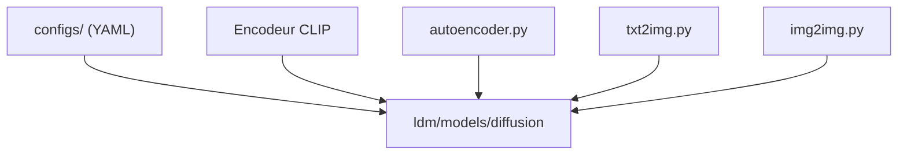

# CompVis/stable-diffusion

> A reference latent text-to-image diffusion model, with sampling scripts, for researchers and practitioners.

## The problem
Generate images from text using an open and reproducible model that can run on a standard GPU.

## What it actually does
Implements Stable Diffusion v1: an 8x factor autoencoder, a 860M parameter UNet, and a frozen 123M CLIP ViT-L/14 text encoder. The `txt2img.py` and `img2img.py` scripts use (PLMS, DDIM) sampling, with security and invisible watermark controls. Four checkpoints (sd-v1-1 to 1-4) are described; the weights can be downloaded from Hugging Face.

## How it is wired


## Trying it
```bash
conda env create -f environment.yaml
conda activate ldm
python scripts/txt2img.py --prompt "a photograph of an astronaut riding a horse" --plms
```

## Cost and gotchas
At least 10 GB of VRAM. Separate recovery weight required under the CreativeML OpenRAIL M license (usage restrictions). License for the repository is not identified by GitHub. Last push on 2024-06-18, research repository.

## What it is not
Not a product: the weights are referred to as "research artifacts," without sufficient safeguards for use in a service. The dependencies are pinned to older versions (`transformers==4.19.2`).

## Alternatives
diffusers: the README refers to it as the area where active community development is focused.

## For you
Important to note: this historical reference provides insight into latent diffusion, but for actual production, it's more effective to use diffusers rather than this fixed deposit.
