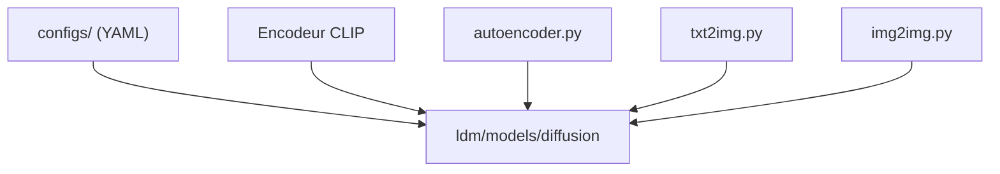

# CompVis/stable-diffusion

> Modèle de diffusion latente texte-vers-image de référence, avec scripts d'échantillonnage, pour chercheurs et praticiens.

## Le problème
Générer des images à partir de texte avec un modèle ouvert et reproductible, qui tienne sur un GPU grand public.

## Ce que ça fait vraiment
Implémente Stable Diffusion v1 : autoencodeur de facteur 8, UNet de 860M de paramètres, encodeur de texte CLIP ViT-L/14 figé de 123M. Des scripts `txt2img.py` et `img2img.py` échantillonnent (PLMS, DDIM), avec contrôle de sécurité et filigrane invisible. Quatre checkpoints (sd-v1-1 à 1-4) sont décrits ; les poids se téléchargent sur Hugging Face.

## Comment c'est branché


## Essayer
```bash
conda env create -f environment.yaml
conda activate ldm
python scripts/txt2img.py --prompt "a photograph of an astronaut riding a horse" --plms
```

## Coût et pièges
Au moins 10 Go de VRAM. Poids à récupérer séparément sous licence CreativeML OpenRAIL M (restrictions d'usage). Licence du dépôt non identifiée par GitHub. Dernier push le 2024-06-18, dépôt de recherche.

## Ce que ce n'est pas
Pas un produit : les poids sont qualifiés de « research artifacts », sans garde-fous suffisants pour un service. Les dépendances sont épinglées à d'anciennes versions (`transformers==4.19.2`).

## Alternatives
diffusers : le README le cite comme intégration où se concentre le développement communautaire actif.

## Pour toi
À surveiller : référence historique pour comprendre la diffusion latente, mais pour de la production, passe par diffusers plutôt que ce dépôt figé.

