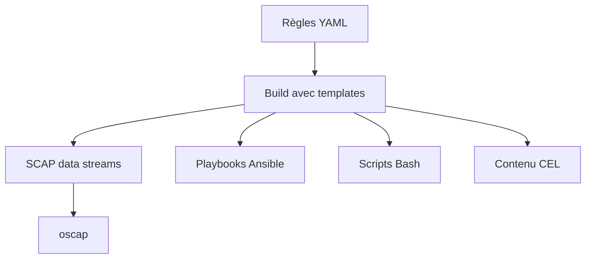

# ComplianceAsCode/content

> Security policy content (SCAP, Ansible, Bash, CEL) for RHEL, Fedora, Ubuntu, Debian and others.

## The problem
Compliance frameworks (CIS, PCI-DSS, STIG) come in incompatible formats, and maintaining them by hand is costly.

## What it actually does
Rules are written once in YAML, then the build system generates SCAP data streams (XCCDF, OVAL), Ansible playbooks, Bash scripts and CEL content for Kubernetes and OpenShift. CCE, NIST and STIG identifiers come from the rule files. The content is evaluated with `oscap`, SCAP Workbench or `oscap-ssh`, on machines, VMs, containers and images.

## How it is wired


## Trying it
```bash
yum install scap-security-guide
oscap xccdf eval --profile xccdf_org.ssgproject.content_profile_ospp --results-arf arf.xml --report report.html --oval-results /usr/share/xml/scap/ssg/content/ssg-rhel8-ds.xml
```

## Cost and gotchas
Free. The remediation playbooks and scripts modify the machine's configuration: the README flags this in capital letters. The license is not identified by GitHub.

## What it is not
Not a scanner: OpenSCAP (`oscap`) is required. Not a data or AI tool, and it is not meant to be applied without review.

## Alternatives
No alternative is named in the README.

## For you
Worth watching: a solid reference if you harden servers or MLOps clusters, otherwise of no direct use for a data / AI profile.
