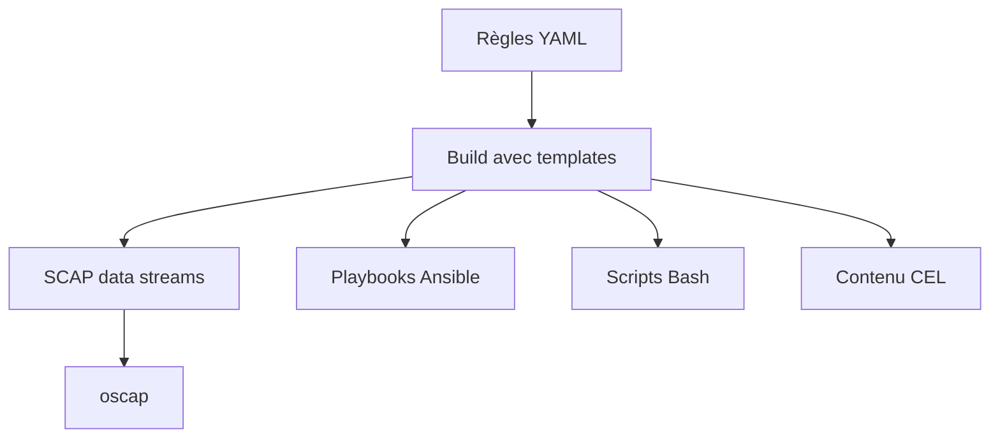

# ComplianceAsCode/content

> Contenu de politiques de sécurité (SCAP, Ansible, Bash, CEL) pour RHEL, Fedora, Ubuntu, Debian et autres.

## Le problème
Les référentiels de conformité (CIS, PCI-DSS, STIG) se déclinent en formats incompatibles, et les maintenir à la main est coûteux.

## Ce que ça fait vraiment
Les règles s'écrivent une fois en YAML, puis le système de build génère des flux de données SCAP (XCCDF, OVAL), des playbooks Ansible, des scripts Bash et du contenu CEL pour Kubernetes et OpenShift. Les identifiants CCE, NIST et STIG viennent des fichiers de règles. Le contenu s'évalue avec `oscap`, SCAP Workbench ou `oscap-ssh`, sur machines, VM, conteneurs et images.

## Comment c'est branché


## Essayer
```bash
yum install scap-security-guide
oscap xccdf eval --profile xccdf_org.ssgproject.content_profile_ospp --results-arf arf.xml --report report.html --oval-results /usr/share/xml/scap/ssg/content/ssg-rhel8-ds.xml
```

## Coût et pièges
Gratuit. Les playbooks et scripts de remédiation modifient la configuration de la machine : le README le signale en majuscules. La licence n'est pas identifiée par GitHub.

## Ce que ce n'est pas
Ce n'est pas un scanner : il faut OpenSCAP (`oscap`). Ce n'est pas un outil data ou IA, et il n'a pas vocation à être appliqué sans revue.

## Alternatives
Aucune alternative n'est nommée dans le README.

## Pour toi
À surveiller : référence solide si tu durcis des serveurs ou des clusters MLOps, sinon sans usage direct pour un profil data / IA.

