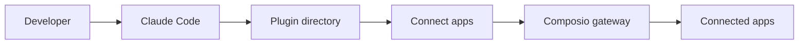

# ComposioHQ/awesome-claude-plugins

> List of Claude Code plugins by category, with a house plugin connecting the agent to 1000+ applications.

## The problem
Finding useful Claude Code plugins in a scattered ecosystem.

## What it actually does
A categorized catalog (integrations, git, quality, DevOps, security, productivity). Some plugins are bundled (audit-project, perf, ship, security-guidance, skill-bus). Loaded with `claude --plugin-dir`.

## How it is wired


## Trying it
```bash
git clone https://github.com/composiohq/awesome-claude-plugins.git
cd awesome-claude-plugins
claude --plugin-dir ./connect-apps
```

## Cost and gotchas
`connect-apps` requires a Composio key. Many of the listed plugins are external and not verified here.

## What it is not
Not an audited set: it is a list with a plugin from its own publisher highlighted. The README says "production-ready"; I do not repeat that.

## Alternatives
The README points to ComposioHQ/awesome-claude-skills for more skills.

## For you
Worth watching: serves as a directory to spot plugins (kaggle-skill, context-mode), to read before installing.
