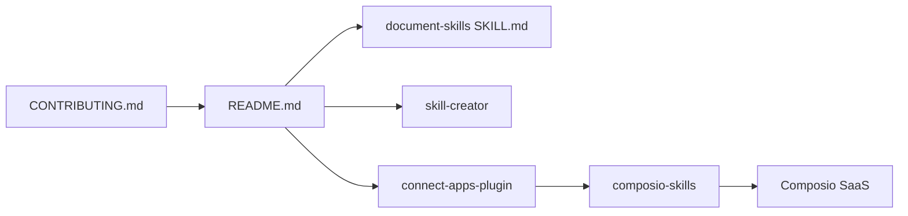

# ComposioHQ/awesome-claude-skills

> A list of over a thousand skills and plugins for Claude and other agents, maintained by Composio.

## The problem
The list of skills for agents is growing without a central index, making it difficult to determine what already exists before creating a new one.

## What it actually does
The `README.md` categorizes skills by domain (documents, code, data, marketing, writing, security, etc.), with a line and often the author for each.
The repository also includes packs: `document-skills` (docx, pdf, pptx, xlsx with OOXML diagrams), creative skills (canvas-design, slack-gif-creator), and skill creation tools (skill-creator, mcp-builder).
The `connect-apps-plugin` connects Claude to over 1,000 apps via the hosted MCP gateway from Composio.

## How it is wired


## Trying it
```bash
claude --plugin-dir ./connect-apps-plugin
# puis, dans Claude : /connect-apps:setup
exit
claude
```

## Cost and gotchas
The "Actions" section requires a Composio key (available for free on dashboard.composio.dev): your calls will go through their service. No license at the repository level; licenses are specific to each package.

## What it is not
Not a neutral list: it also serves as a showcase for the Composio platform. The skills listed are not audited, and many come from third-party providers.

## Alternatives
No alternative is specified in the README file.

## For you
Treat it like a directory: review each skill before installing it, and avoid using SaaS solutions unless there is a genuine need.
