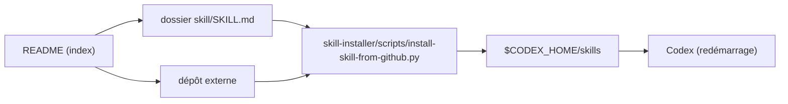

# ComposioHQ/awesome-codex-skills

> List of Codex skills sorted by theme, with an installer, for anyone equipping Codex CLI.

## The problem
Skills for Codex are scattered across third-party repositories; without an index, there is no way to know which ones exist or how to install them.

## What it actually does
An index of skills in five sections (development, productivity, communication, data, meta). Some live in the repository (folders with `SKILL.md`), others point to external repositories. A script `install-skill-from-github.py` copies a skill into `$CODEX_HOME/skills`. Several skills go through the Composio CLI, and therefore through the Composio service.

## How it is wired


## Trying it
```bash
git clone https://github.com/ComposioHQ/awesome-codex-skills.git
cd awesome-codex-skills
python skill-installer/scripts/install-skill-from-github.py --repo ComposioHQ/awesome-codex-skills --path meeting-notes-and-actions
```

## Cost and gotchas
Free, but the "connect" skills rely on Composio's CLI and MCP gateway (1,000+ integrations advertised), and therefore on a third-party account. Restart Codex after installation.

## What it is not
Not an audited catalog: each external skill has its own maintainer and its own license. No license is declared on the repository itself. The README also serves as a showcase for Composio.

## Alternatives
- hyhmrright/brooks-lint, yujiachen-y/codebase-recon-skill: cited external skills, to be installed directly without going through the list.

## For you
Worth watching as a directory of Codex skills, not to be adopted as is: no license, and several entries depend on Composio.
