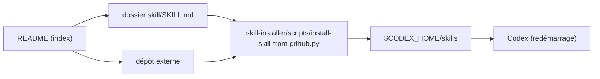

# ComposioHQ/awesome-codex-skills

> Liste de skills Codex classés par thème, avec un installeur, pour qui outille Codex CLI.

## Le problème
Les skills pour Codex sont dispersés dans des dépôts tiers ; sans index, impossible de savoir lesquels existent ou comment les installer.

## Ce que ça fait vraiment
Un index de skills en cinq rubriques (développement, productivité, communication, données, méta). Certains vivent dans le dépôt (dossiers avec `SKILL.md`), d'autres pointent vers des dépôts externes. Un script `install-skill-from-github.py` copie un skill dans `$CODEX_HOME/skills`. Plusieurs skills passent par la CLI Composio, donc par le service Composio.

## Comment c'est branché


## Essayer
```bash
git clone https://github.com/ComposioHQ/awesome-codex-skills.git
cd awesome-codex-skills
python skill-installer/scripts/install-skill-from-github.py --repo ComposioHQ/awesome-codex-skills --path meeting-notes-and-actions
```

## Coût et pièges
Gratuit, mais les skills « connect » reposent sur la CLI et la passerelle MCP de Composio (1 000+ intégrations annoncées), donc sur un compte tiers. Redémarrer Codex après installation.

## Ce que ce n'est pas
Pas un catalogue audité : chaque skill externe a son propre mainteneur et sa propre licence. Aucune licence n'est déclarée sur le dépôt lui-même. Le README sert aussi de vitrine pour Composio.

## Alternatives
- hyhmrright/brooks-lint, yujiachen-y/codebase-recon-skill : skills externes cités, à installer directement sans passer par la liste.

## Pour toi
À surveiller comme annuaire de skills Codex, pas à adopter tel quel : pas de licence, et plusieurs entrées dépendent de Composio.

