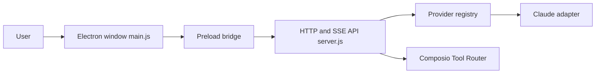

# ComposioHQ/open-claude-cowork

> Electron desktop application to chat with Claude and 500+ apps through Composio.

## The problem
Connecting an agent to Gmail, Slack or GitHub means writing the integrations and authentication yourself.

## What it actually does
An Electron window calls an Express server, which passes messages to the Claude Agent SDK or to Opencode. Tools come from the Composio Tool Router (MCP), and responses arrive via SSE. Skills are loaded from `.claude/skills/`.

## How it is wired


## Trying it
```bash
git clone https://github.com/ComposioHQ/open-claude-cowork.git
cd open-claude-cowork
./setup.sh
cd server && npm start
npm start
```

## Cost and gotchas
An Anthropic key and a Composio key are required. Actions go through the Composio service.

## What it is not
The README also presents "Secure Clawdbot", but its code is absent from the analyzed tree. It is not an offline client.

## Alternatives
No alternative named in the README.

## For you
Ignore: little value for a data/MLOps profile, dependence on Composio, and half of what the repository announces is missing.
