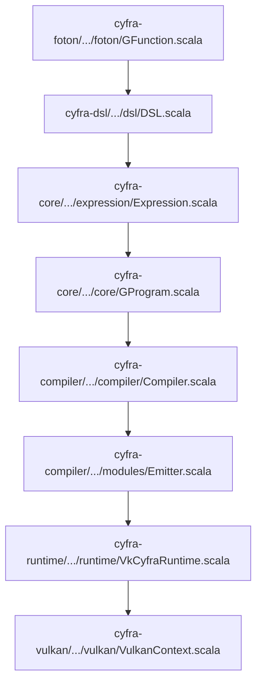

# ComputeNode/cyfra

> Scala 3 library that compiles a DSL to SPIR-V to run computation on the GPU via Vulkan.

## The problem
Writing portable GPU compute (Nvidia, AMD, Intel, Apple) forces you through shaders or low-level C++, far from a high-level typed language.

## What it actually does
The Scala 3 DSL builds expressions grouped into GPU programs (GProgram). The compiler emits them as SPIR-V, which the runtime executes through the Vulkan context. The Foton library adds a high-level API (GFunction) for functions and ray-traced animations.

## How it is wired


## Trying it
```bash
scala filename.scala
```
(file with the directives `//> using scala "3.6.4"` and `//> using dep "io.computenode::cyfra-foton:0.1.0-RC1"`, multiplyByTwo example from the README)

## Cost and gotchas
A Vulkan-compatible GPU is required; on Mac, MoltenVK and extra LWJGL dependencies. The project is at release candidate 0.1.0-RC1 and stays on the JVM side, not Python.

## What it is not
Not an equivalent of CUDA or PyTorch: no machine-learning tooling is documented. Most of the README examples are reduced to "code".

## Alternatives
No alternative named in the README.

## For you
Worth watching only: interesting for GPU compute in Scala, but unrelated to the Python data/AI ecosystem and still at release-candidate stage.
