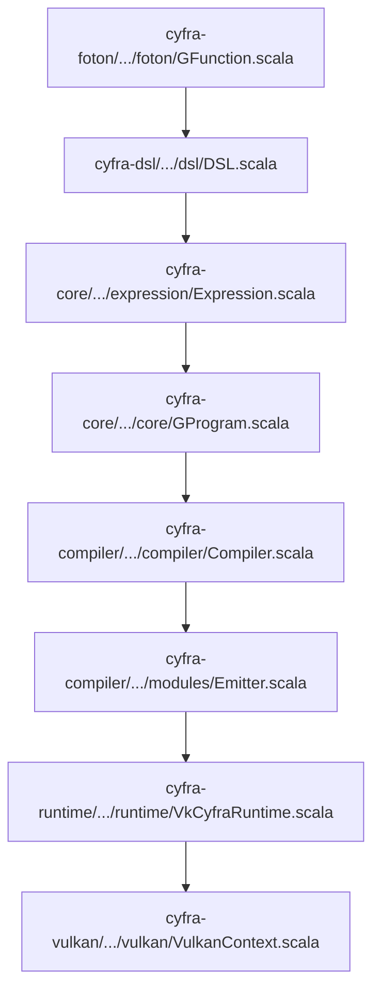

# ComputeNode/cyfra

> Bibliothèque Scala 3 qui compile un DSL vers SPIR-V pour exécuter du calcul sur GPU via Vulkan.

## Le problème
Écrire du calcul GPU portable (Nvidia, AMD, Intel, Apple) oblige à passer par des shaders ou du C++ bas niveau, loin d'un langage typé de haut niveau.

## Ce que ça fait vraiment
Le DSL Scala 3 construit des expressions regroupées en programmes GPU (GProgram). Le compilateur les émet en SPIR-V, que le runtime exécute via le contexte Vulkan. La bibliothèque Foton ajoute une API haut niveau (GFunction) pour fonctions et animations ray tracées.

## Comment c'est branché


## Essayer
```bash
scala filename.scala
```
(fichier avec les directives `//> using scala "3.6.4"` et `//> using dep "io.computenode::cyfra-foton:0.1.0-RC1"`, exemple multiplyByTwo du README)

## Coût et pièges
Il faut un GPU compatible Vulkan ; sur Mac, MoltenVK et des dépendances LWJGL supplémentaires. Le projet est en version candidate 0.1.0-RC1 et reste côté JVM, pas Python.

## Ce que ce n'est pas
Ce n'est pas un équivalent de CUDA ou PyTorch : aucun outil d'apprentissage automatique n'est documenté. La plupart des exemples du README sont réduits à « code ».

## Alternatives
Aucune alternative nommée dans le README.

## Pour toi
À surveiller seulement : intéressant pour du calcul GPU en Scala, mais sans lien avec l'écosystème Python data/IA et encore en version candidate.

