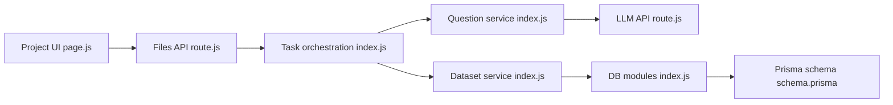

# ConardLi/easy-dataset

> Local application that turns documents into QA datasets for fine-tuning, RAG and evaluation.

## The problem
Producing a fine-tuning dataset from business PDFs requires chunking, question generation, cleaning and export in the right format.

## What it actually does
Ingestion of PDF/DOCX/EPUB/Markdown, chunking (Markdown structure, recursive, fixed size, code), label tree.
Generation of questions, answers and reasoning chains via LLM (OpenAI-compatible, Ollama, OpenRouter…), as background tasks.
Simple, multi-turn and image QA datasets; evaluation sets, LLM judge and blind test.
Export Alpaca/ShareGPT in JSON/JSONL, LLaMA Factory config, upload to Hugging Face; local Prisma storage.

## How it is wired


## Trying it
```bash
git clone https://github.com/ConardLi/easy-dataset.git
cd easy-dataset
npm install
npm run build
npm run start
docker-compose up -d
```

## Cost and gotchas
LLM calls are at your expense (or local Ollama). Local database to be mounted as a volume (`local-db`, `prisma`).

## What it is not
Not a training tool: it prepares the data, training happens elsewhere (LLaMA Factory). Quality depends on the chosen LLM.

## Alternatives
No alternative named in the README.

## For you
Worth adopting to quickly prototype a fine-tuning or RAG evaluation dataset on a business corpus, checking the license before commercial use.
