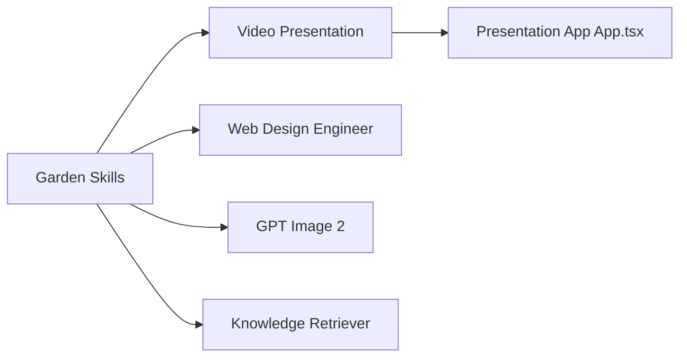

# ConardLi/garden-skills

> Collection of six agent skills for web video presentations, design, images, articles and a local knowledge base.

## The problem
Agents produce generic pages and materials; each task requires rewriting the same know-how.

## What it actually does
Six skills: `web-video-presentation` (16:9 presentations to record, 23 themes, MiniMax or OpenAI TTS), `web-design-engineer` (25 style recipes), `gpt-image-2` (image generation, 79 prompt templates), `kb-retriever` (search in a `knowledge/` folder limited to 5 turns), `beautiful-article` (editorial formatting), `motion-showreel` (deterministic short videos). Five installation routes, including pinned versions as `.zip` with a SHA-256 checksum.

## How it is wired


## Trying it
```bash
npx skills add ConardLi/garden-skills
npx skills add ConardLi/garden-skills -s kb-retriever -a claude-code
/plugin marketplace add ConardLi/garden-skills
```

## Cost and gotchas
Free; image generation and speech synthesis require external keys. Compatibility is declared as tested on six agents, without detailed measurement.

## What it is not
Not an application: a set of instructions and scripts. The implementation of several skills is not visible in the architecture diagram.

## Alternatives
The reference repository anthropics/skills is cited in the acknowledgments.

## For you
Ignore: mostly oriented toward content creation and design; only `kb-retriever` touches document search.
