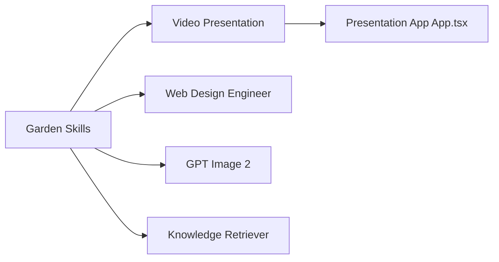

# ConardLi/garden-skills

> Collection de six skills d'agent pour présentations vidéo web, design, images, articles et base locale.

## Le problème
Les agents produisent des pages et des supports génériques ; chaque tâche demande de réécrire le même savoir-faire.

## Ce que ça fait vraiment
Six skills : `web-video-presentation` (présentations 16:9 à enregistrer, 23 thèmes, TTS MiniMax ou OpenAI), `web-design-engineer` (25 recettes de style), `gpt-image-2` (génération d'images, 79 modèles de prompts), `kb-retriever` (recherche dans un dossier `knowledge/` limitée à 5 tours), `beautiful-article` (mise en forme éditoriale), `motion-showreel` (vidéos courtes déterministes). Cinq voies d'installation, dont versions épinglées en `.zip` avec somme SHA-256.

## Comment c'est branché


## Essayer
```bash
npx skills add ConardLi/garden-skills
npx skills add ConardLi/garden-skills -s kb-retriever -a claude-code
/plugin marketplace add ConardLi/garden-skills
```

## Coût et pièges
Gratuit ; la génération d'images et la synthèse vocale demandent des clés externes. La compatibilité est déclarée testée sur six agents, sans mesure détaillée.

## Ce que ce n'est pas
Pas une application : un lot de consignes et de scripts. L'implémentation de plusieurs skills n'est pas visible dans le schéma d'architecture.

## Alternatives
Le dépôt de référence anthropics/skills est cité en remerciements.

## Pour toi
À ignorer : surtout orienté création de contenu et design ; seul `kb-retriever` touche à la recherche documentaire.

