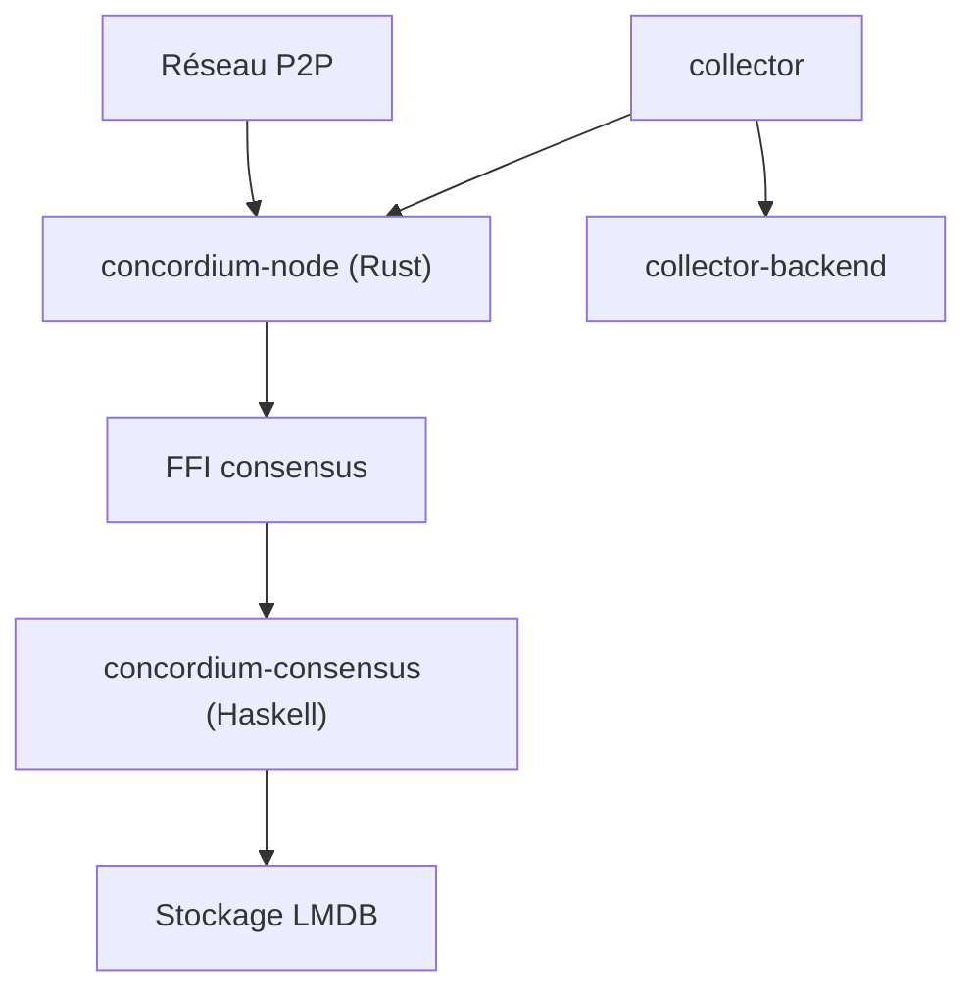

# Concordium/concordium-node

> Peer-to-peer node of the Concordium blockchain, with consensus in Haskell and networking in Rust.

## The problem
Taking part in the Concordium network requires a node that runs consensus, finalization and the network layer.

## What it actually does
Two parts: `concordium-consensus` (Haskell: consensus, finalization, scheduler, block storage) and `concordium-node` (Rust: executables including `concordium-node.rs`, network layer). Added to these are a collector, a collection backend for the network dashboard and a macOS logging wrapper. gRPC interface defined by a submodule.

## How it is wired


## Trying it
```bash
git submodule update --init --recursive
fourmolu --mode check $(git ls-files '*.hs')
# la compilation du nœud est décrite dans concordium-node/README.md
```

## Cost and gotchas
Free. Recursive clone mandatory. Rust 1.82 and Haskell (stack) to build; AGPL-3.0.

## What it is not
Not a contract development tool nor a wallet: it is the node implementation.

## Alternatives
No alternative named in the README.

## For you
Ignore: blockchain infrastructure unrelated to your work, under the AGPL license.
