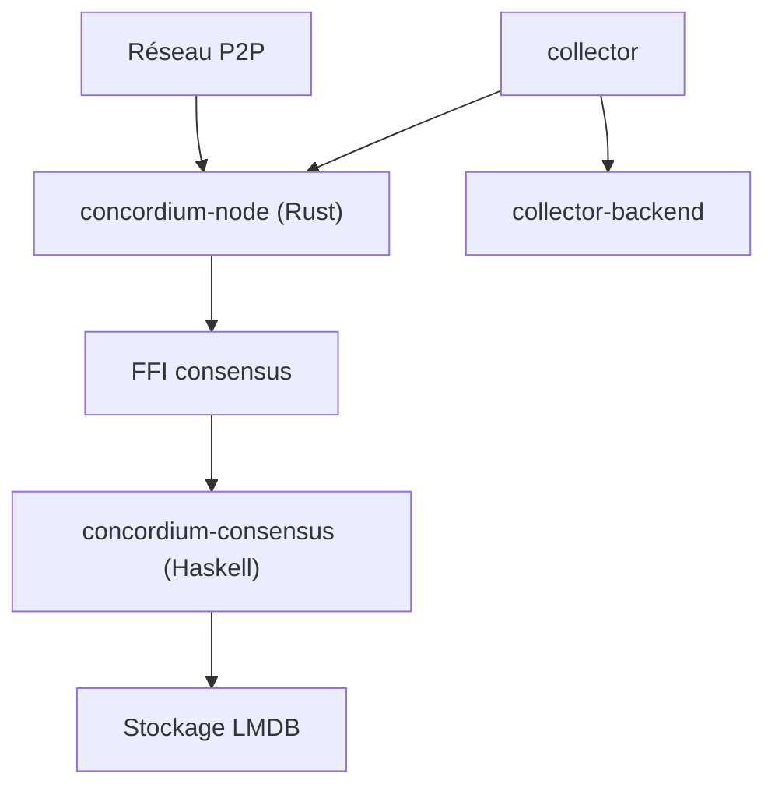

# Concordium/concordium-node

> Nœud pair-à-pair de la blockchain Concordium, avec consensus en Haskell et réseau en Rust.

## Le problème
Participer au réseau Concordium demande un nœud qui exécute le consensus, la finalisation et la couche réseau.

## Ce que ça fait vraiment
Deux parties : `concordium-consensus` (Haskell : consensus, finalisation, ordonnanceur, stockage des blocs) et `concordium-node` (Rust : exécutables dont `concordium-node.rs`, couche réseau). S'y ajoutent un collecteur, un backend de collecte pour le tableau de bord réseau et un enrobage de journalisation macOS. Interface gRPC définie par un sous-module.

## Comment c'est branché


## Essayer
```bash
git submodule update --init --recursive
fourmolu --mode check $(git ls-files '*.hs')
# la compilation du nœud est décrite dans concordium-node/README.md
```

## Coût et pièges
Gratuit. Clonage récursif obligatoire. Rust 1.82 et Haskell (stack) pour construire ; AGPL-3.0.

## Ce que ce n'est pas
Pas un outil de développement de contrats ni un portefeuille : c'est l'implémentation du nœud.

## Alternatives
Aucune alternative nommée dans le README.

## Pour toi
Ignorer : infrastructure blockchain sans lien avec ton métier, sous licence AGPL.

