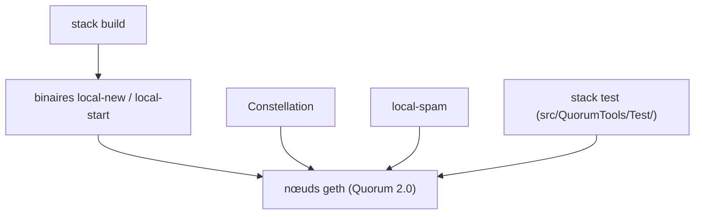

# Consensys/quorum-tools

> Haskell tools for launching Quorum clusters and testing them, now abandoned.

## The problem
Testing the integration of a Quorum blockchain requires setting up clusters of nodes and injecting failures into them.

## What it actually does
Haskell binaries create and start a local cluster (`local-new`, `local-start`), send a rate-limited stream of transactions (`local-spam`) and run integration tests: adding and removing nodes, network partitions, consistency of public and private state, restarts, member revocation.

## How it is wired
Simplified diagram based on the sheet, no diagram provided.


## Trying it
```bash
stack setup
stack build
stack exec -- local-new
sudo whoami && stack test
```

## Cost and gotchas
Haskell Stack, Quorum 2.0 and Constellation in the PATH, and `sudo` for packet filtering. The repository is archived and declared obsolete; last push in 2022.

## What it is not
Not a maintained tool: the deprecation notice appears at the top of the README.

## Alternatives
No alternative named in the README.

## For you
Ignore: archived and deprecated, tied to an old version of Quorum.
