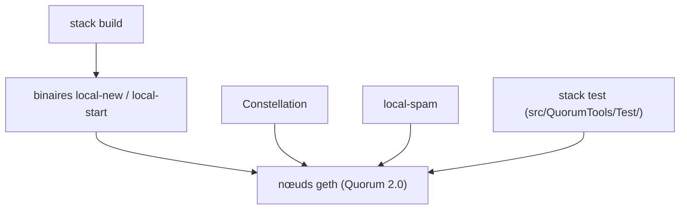

# Consensys/quorum-tools

> Outils Haskell pour lancer des grappes Quorum et les tester, désormais abandonnés.

## Le problème
Tester l'intégration d'une blockchain Quorum demande de monter des grappes de nœuds et d'y injecter des pannes.

## Ce que ça fait vraiment
Des binaires Haskell créent et démarrent une grappe locale (`local-new`, `local-start`), envoient un flux de transactions limité en débit (`local-spam`) et exécutent des tests d'intégration : ajout et retrait de nœuds, partitions réseau, cohérence de l'état public et privé, redémarrages, révocation de membres.

## Comment c'est branché
Schéma simplifié d'après la fiche, sans diagramme fourni.


## Essayer
```bash
stack setup
stack build
stack exec -- local-new
sudo whoami && stack test
```

## Coût et pièges
Haskell Stack, Quorum 2.0 et Constellation dans le PATH, et `sudo` pour le filtrage de paquets. Le dépôt est archivé et déclaré obsolète ; dernier push en 2022.

## Ce que ce n'est pas
Pas un outil maintenu : l'avis de dépréciation figure en tête du README.

## Alternatives
Aucune alternative nommée dans le README.

## Pour toi
À ignorer : archivé et déprécié, lié à une version ancienne de Quorum.

