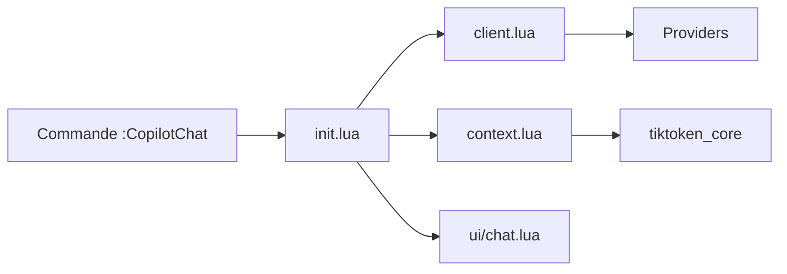

# CopilotC-Nvim/CopilotChat.nvim

> Neovim plugin that opens a GitHub Copilot chat inside the editor, with file context and approved tool calls.

## The problem
Leaving Neovim to ask an LLM about your code breaks your flow; copy-pasting context by hand is tedious.

## What it actually does
A chat window where you reference resources (`#buffer`, `#file`, `#gitdiff`, `#url`), tools (`@copilot`: bash, edit, grep…) and predefined prompts (Explain, Review, Fix, Tests, Commit). Tool calls require manual approval by default. Providers: Copilot, GitHub Models, or custom ones (Ollama, Mistral are mentioned).

## How it is wired


## Trying it
```lua
{
  "CopilotC-Nvim/CopilotChat.nvim",
  dependencies = { { "nvim-lua/plenary.nvim", branch = "master" } },
  build = "make tiktoken",
  opts = {},
}
```

## Cost and gotchas
Requires Neovim 0.10+, curl 8+, plenary.nvim and Copilot Chat enabled in GitHub. `trusted_tools = true` lets the model run bash without asking.

## What it is not
Not a model nor a free service: access goes through your Copilot subscription. GPL-3.0 license.

## Alternatives
- mcphub.nvim: MCP tool integration, mentioned as a complement.

## For you
Worth watching: only useful if you live in Neovim and already pay for Copilot; the dependency on GitHub is the real lock.
