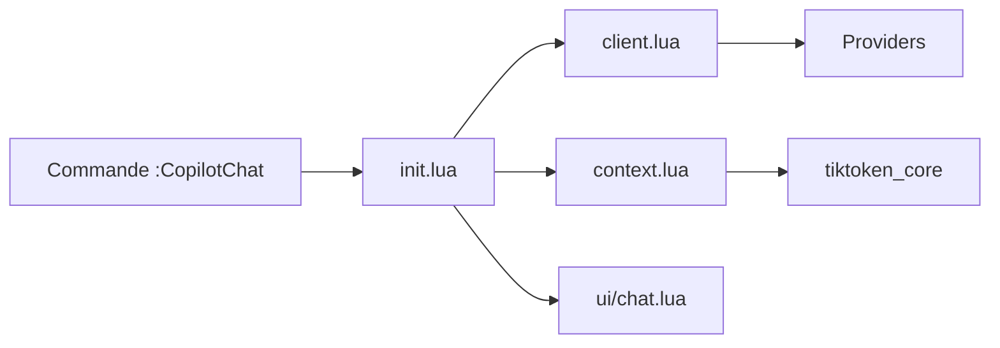

# CopilotC-Nvim/CopilotChat.nvim

> Plugin Neovim qui ouvre un chat GitHub Copilot dans l'éditeur, avec contexte de fichiers et appels d'outils approuvés.

## Le problème
Quitter Neovim pour interroger un LLM sur son code casse le flux ; copier-coller le contexte à la main est fastidieux.

## Ce que ça fait vraiment
Fenêtre de chat où l'on cite des ressources (`#buffer`, `#file`, `#gitdiff`, `#url`), des outils (`@copilot` : bash, edit, grep…) et des prompts prédéfinis (Explain, Review, Fix, Tests, Commit). Les appels d'outils demandent une approbation manuelle par défaut. Fournisseurs : Copilot, GitHub Models, ou personnalisés (Ollama, Mistral cités).

## Comment c'est branché


## Essayer
```lua
{
  "CopilotC-Nvim/CopilotChat.nvim",
  dependencies = { { "nvim-lua/plenary.nvim", branch = "master" } },
  build = "make tiktoken",
  opts = {},
}
```

## Coût et pièges
Exige Neovim 0.10+, curl 8+, plenary.nvim et Copilot Chat activé dans GitHub. `trusted_tools = true` laisse le modèle exécuter bash sans demander.

## Ce que ce n'est pas
Pas un modèle ni un service gratuit : l'accès passe par ton abonnement Copilot. Licence GPL-3.0.

## Alternatives
- mcphub.nvim : intégration d'outils MCP, citée comme complément.

## Pour toi
À surveiller : utile seulement si tu vis dans Neovim et paies déjà Copilot ; la dépendance à GitHub est le vrai verrou.

